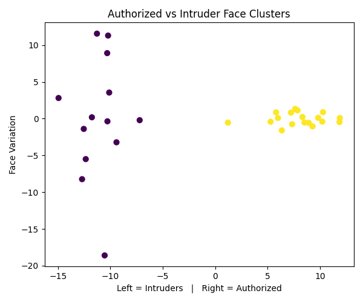

# AI-Powered CCTV Intruder Detection System

> A real-time AI-powered CCTV Intruder Detection System that performs face authentication using InsightFace embeddings, detects unauthorized individuals, and automatically sends email alerts with captured intrusion images.


---
## ⭐ Key Highlights

- 🎯 95%+ Face Recognition Accuracy
- 🧠 512-D InsightFace Face Embeddings
- 🤖 Evaluated 5 Machine Learning Models
- ⚡ ~40% Faster Inference using Optimizations
- 📧 Automated Email Alerts with Captured Intruder Images
---

## 📸 Demo

### Real-Time Intruder Detection

The animation below demonstrates the complete detection pipeline, including authorized user verification, intruder detection, and automated email alerts.

<p align="center">

</p>


---

## 📧 Email Alert
The system automatically sends an email notification containing the captured intruder image whenever an unauthorized individual is detected.

<p align="center">

</p>

---

## 📊 PCA Visualization

The visualization below shows the PCA projection of the generated face embeddings used for model evaluation.

<p align="center">

</p>

---

# 🚀 Features

- Real-time CCTV monitoring
- Face authentication using **512-dimensional InsightFace embeddings**
- Cosine similarity-based face verification
- Multi-threaded video capture for low-latency processing
- Automatic intruder detection
- Automatic email alerts with captured intrusion images
- Duplicate intruder suppression
- Frame skipping for faster inference
- Image downscaling for improved performance
- GPU acceleration support
- Machine Learning model evaluation
- PCA visualization of face embeddings

---

# 🏗️ System Workflow

```text
Camera
   │
   ▼
Capture Frame
   │
   ▼
Detect Faces
   │
   ▼
Generate 512-D Face Embeddings
   │
   ▼
Cosine Similarity Comparison
   │
 ┌─┴────────────┐
 │              │
 ▼              ▼
Authorized   Intruder
                │
                ▼
      Save Intruder Image
                │
                ▼
      Send Email Notification
```

---

# 🧠 Machine Learning Model Evaluation

The extracted **512-dimensional face embeddings** were evaluated using multiple Machine Learning classifiers.

### Models Evaluated

- K-Nearest Neighbors (KNN)
- Logistic Regression
- Linear Support Vector Machine (SVM)
- Random Forest
- Gaussian Naive Bayes

### Evaluation Metrics

- Accuracy
- Precision
- Recall
- F1 Score

Principal Component Analysis (PCA) was also used to visualize the distribution of face embeddings in a lower-dimensional space.

---

# ⚡ Performance Optimizations

- Multi-threaded webcam streaming
- Webcam buffer optimization
- Frame skipping
- Image downscaling
- Cosine similarity matching
- Duplicate intruder suppression
- Background email processing
- GPU acceleration support

---

# 🛠️ Technologies Used

| Category | Technologies |
|----------|--------------|
| Programming Language | Python |
| Computer Vision | OpenCV, InsightFace |
| Machine Learning | Scikit-learn, KNN, Logistic Regression, SVM, Random Forest, Gaussian Naive Bayes, PCA |
| Libraries | NumPy, Matplotlib |
| Networking | SMTP |
| Concurrency | Python Threading |

---

# 📂 Project Structure

```text
cctv-intruder-project
│
├── authorized_faces/
│   └── README.md
│
├── images/
│   ├── demo.gif
│   ├── email_alert.png
│   └── pca_plot.png
│
├── intruder_faces/
│   └── README.md
│
├── .gitignore
├── LICENSE
├── main.py
├── ml_evaluation_report.txt
├── model_comparison.txt
├── README.md
└── requirements.txt
```

---

# ⚙️ Installation

Clone the repository

```bash
git clone https://github.com/lakshitmehta/cctv-intruder-project.git

cd cctv-intruder-project
```

Create a virtual environment

### Windows

```bash
python -m venv venv
venv\Scripts\activate
```

### Linux / macOS

```bash
python3 -m venv venv
source venv/bin/activate
```

Install dependencies

```bash
pip install -r requirements.txt
```

---

# 🔐 Environment Variables

Create a `.env` file in the project root.

```env
EMAIL=your_email@gmail.com
EMAIL_PASSWORD=your_app_password
RECEIVER_EMAIL=receiver_email@gmail.com
```

---

# 👤 Setting Up Authorized Faces

Before running the project, create a folder named:

```text
authorized_faces
```

Add one or more clear front-facing images of every authorized person.

Example:

```text
authorized_faces/
├── person1.jpg
├── person2.jpg
├── person3.jpg
```

### Recommended Image Guidelines

- Clear front-facing image
- Good lighting
- One face per image
- JPG, JPEG or PNG format
- Avoid sunglasses and face masks

The application automatically extracts face embeddings from these images during startup. Any face that does not sufficiently match these embeddings is classified as an intruder.

---

# ▶️ Running the Project

```bash
python main.py
```

Press **Q** to quit.

---

# 📈 Experimental Results

| Metric | Value |
|---------|------:|
| Face Recognition Accuracy | **95%+** |
| Face Embedding Dimension | **512** |
| Machine Learning Models Evaluated | **5** |
| Inference Latency Reduction | **~40%** |
| Similarity Metric | **Cosine Similarity** |

---

# 🔮 Future Improvements

- Multi-camera support
- Cloud storage integration
- Telegram / WhatsApp notifications
- Web dashboard
- Mobile application
- Face recognition logs
- Attendance management
- Database integration

---

# 🤝 Contributing

Contributions, feature requests, and improvements are welcome.

Feel free to fork the repository and submit a Pull Request.

---

# 👨‍💻 Author

**Lakshit Mehta**

📧 Email:
lakshitmehta1work@gmail.com

💻 GitHub:
https://github.com/lakshitmehta

🔗 LinkedIn:
(https://www.linkedin.com/in/lakshit-mehta-4087b437a/)

---

# 📄 License

This project is licensed under the MIT License.
