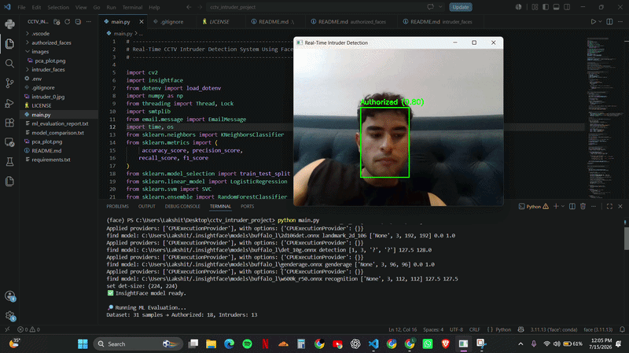

# AI-Powered CCTV Intruder Detection System

A real-time AI-powered CCTV Intruder Detection System that performs face authentication using InsightFace embeddings, detects unauthorized individuals, and automatically sends email alerts with captured intrusion images. The system also integrates a feedback-based Reinforcement Learning (RL) module to learn from user feedback and control alert decisions.


---

## ⭐ Key Highlights

- 🎯 Face authentication using InsightFace
- 🧠 512-dimensional face embeddings
- 🤖 Evaluation of 5 Machine Learning classifiers
- 🔄 Feedback-based Reinforcement Learning integration
- 🎮 RL agent with MONITOR and ALERT actions
- 📈 Reward-based learning using human feedback
- 💾 Persistent RL learning across executions
- 📧 Automated email alerts with captured intruder images
- ⚡ Optimized real-time inference using frame skipping and image downscaling
- 📊 PCA visualization of face embeddings

---

## 📸 Demo

### Real-Time Intruder Detection

The system performs face detection, face authentication, intruder identification, and automated email notifications.

<p align="center">

</p>

---

## 📧 Email Alert

The system can send an email notification containing the captured intruder image when an intruder candidate satisfies the alert conditions.

<p align="center">

</p>

---

## 🧠 Reinforcement Learning Integration

A feedback-based Reinforcement Learning module is integrated into the existing intruder detection and email-alert pipeline.

The RL agent learns from user feedback to update the values associated with its alert decisions.

### Actions

The agent has two possible actions:

| Action | Description |
|---|---|
| MONITOR | Continue monitoring and tracking the intruder candidate without sending an email alert |
| ALERT | Allow the existing email-alert mechanism to proceed when its conditions are satisfied |

### Human Feedback

Users can provide feedback through keyboard inputs during real-time monitoring:

| Key | Feedback |
|---|---|
| `I` | The detected person is an intruder |
| `U` | The detected person is authorized |

### Reward Mechanism

The agent receives feedback in the form of rewards:

| Action | Feedback | Reward |
|---|---|---:|
| ALERT | Intruder | +1 |
| ALERT | Authorized | -1 |
| MONITOR | Authorized | +1 |
| MONITOR | Intruder | -1 |

The reward is used to update the learned value of the selected action.

### Learning Mechanism

The agent updates its action value using a learning-rate-based update rule:

\[
Q_{\text{new}}=Q_{\text{old}}+\alpha(R-Q_{\text{old}})
\]

Where:

- \(Q_{\text{old}}\): Previous action value
- \(Q_{\text{new}}\): Updated action value
- \(\alpha\): Learning rate
- \(R\): Reward received

The agent selects the action with the highest learned value.

### Persistent Learning

The learned action values are stored in:

```text
rl_action_values.json
```

This allows the system to retain feedback-based learning across multiple executions.

**Note:** The RL module is a simplified feedback-based action-value learning mechanism. The original face-recognition model and classification threshold remain unchanged.

---

## 🏗️ System Workflow

```text
Camera
   |
   v
Capture Frame
   |
   v
Detect Faces
   |
   v
Generate 512-D Face Embeddings
   |
   v
Cosine Similarity Comparison
   |
   v
Original Threshold Classification
   |
   +-------------------+
   |                   |
   v                   v
Authorized       Intruder Candidate
                       |
                       v
                 RL Agent Decision
                       |
                 MONITOR / ALERT
                       |
             +---------+---------+
             |                   |
             v                   v
          MONITOR              ALERT
             |                   |
             v                   v
      Continue Tracking    Existing Email
                           Alert Conditions
                                |
                                v
                       Send Email Notification

User Feedback:
I = Intruder
U = Authorized
        |
        v
Reward Calculation (+1 / -1)
        |
        v
Update Action Value
        |
        v
Save Learned Values
```

---

## 🚀 Features

### Computer Vision

- Real-time CCTV monitoring
- Face detection using InsightFace
- Face authentication using 512-dimensional embeddings
- Cosine similarity-based face verification
- Authorized face template generation using average embeddings
- Automatic intruder candidate detection

### Reinforcement Learning

- Feedback-based alert decision learning
- MONITOR and ALERT actions
- Human feedback using `I` and `U` keys
- Reward-based action-value updates
- Persistent learning through JSON storage

### Alert System

- Automatic email alerts
- Captured intruder images attached to email
- Duplicate intruder suppression
- Intruder tracking
- Configurable email delay and retry intervals

### Performance Optimizations

- Multi-threaded webcam streaming
- Webcam buffer optimization
- Frame skipping
- Image downscaling
- Background email processing
- Duplicate intruder suppression

### Machine Learning Evaluation

- Evaluation of multiple classifiers using face embeddings
- Accuracy
- Precision
- Recall
- F1 Score
- PCA visualization

---

## 🧠 Machine Learning Model Evaluation

The extracted 512-dimensional face embeddings are evaluated using multiple Machine Learning classifiers.

### Models Evaluated

- K-Nearest Neighbors (KNN)
- Logistic Regression
- Linear Support Vector Machine (SVM)
- Random Forest
- Gaussian Naive Bayes

### Evaluation Metrics

- Accuracy
- Precision
- Recall
- F1 Score

Principal Component Analysis (PCA) is used to visualize the distribution of face embeddings in a lower-dimensional space.

---

## 📊 PCA Visualization

The PCA visualization shows the projection of face embeddings into a two-dimensional space.

<p align="center">

</p>

---

## ⚡ Performance Optimizations

- Multi-threaded webcam streaming
- Webcam buffer optimization
- Frame skipping
- Image downscaling
- Cosine similarity matching
- Duplicate intruder suppression
- Background email processing

---

## 🛠️ Technologies Used

| Category | Technologies |
|---|---|
| Programming Language | Python |
| Computer Vision | OpenCV, InsightFace |
| Machine Learning | Scikit-learn |
| ML Models | KNN, Logistic Regression, SVM, Random Forest, Gaussian Naive Bayes |
| Dimensionality Reduction | PCA |
| Reinforcement Learning | Feedback-based action-value learning |
| Libraries | NumPy, Matplotlib |
| Networking | SMTP |
| Concurrency | Python Threading |

---

## 📂 Project Structure

```text
cctv-intruder-project
│
├── authorized_faces/
│   └── README.md
│
├── intruder_faces/
│   └── README.md
│
├── images/
│   ├── demo.gif
│   ├── email_alert.png
│   └── pca_plot.png
│
├── .gitignore
├── LICENSE
├── main.py
├── requirements.txt
├── ml_evaluation_report.txt
├── model_comparison.txt
├── README.md
└── rl_action_values.json
```

`rl_action_values.json` is generated at runtime and stores the learned RL action values.

---

## ⚙️ Installation

### Clone the repository

```bash
git clone https://github.com/lakshitmehta/cctv-intruder-project.git

cd cctv-intruder-project
```

### Create a virtual environment

#### Windows

```bash
python -m venv venv
venv\Scripts\activate
```

#### Linux / macOS

```bash
python3 -m venv venv
source venv/bin/activate
```

### Install dependencies

```bash
pip install -r requirements.txt
```

---

## 🔐 Environment Variables

Create a `.env` file in the project root.

```env
EMAIL=your_email@gmail.com
EMAIL_PASSWORD=your_app_password
RECEIVER_EMAIL=receiver_email@gmail.com
```

Use a Google App Password for SMTP authentication.

**Do not upload your `.env` file or email credentials to GitHub.**

---

## 👤 Setting Up Authorized Faces

Create a folder named:

```text
authorized_faces
```

Add clear images of authorized individuals.

Example:

```text
authorized_faces/
├── person1.jpg
├── person2.jpg
└── person3.jpg
```

### Recommended Image Guidelines

- Clear front-facing image
- Good lighting
- One face per image
- JPG, JPEG, or PNG format
- Avoid sunglasses and face masks

The application automatically extracts face embeddings from these images during startup.

---

## ▶️ Running the Project

```bash
python main.py
```

### Keyboard Controls

| Key | Action |
|---|---|
| `I` | Provide feedback that the detected person is an intruder |
| `U` | Provide feedback that the detected person is authorized |
| `Q` | Exit the application |

---

## 📈 Experimental Results

| Metric | Value |
|---|---:|
| Face Embedding Dimension | 512 |
| ML Models Evaluated | 5 |
| Similarity Metric | Cosine Similarity |
| RL Actions | 2 |
| Reward Values | +1 / -1 |

Additional performance metrics should be reported based on the actual experimental results generated by the system.

---

## 🔮 Future Improvements

- Multi-camera support
- Cloud storage integration
- Telegram / WhatsApp notifications
- Web dashboard
- Mobile application
- Face recognition logs
- Attendance management
- Database integration
- Context-aware RL states
- More advanced reinforcement-learning algorithms
- Improved multi-person feedback association

---

## 🤝 Contributing

Contributions, feature requests, and improvements are welcome.

Feel free to fork the repository and submit a Pull Request.

---

## 👨‍💻 Author

**Lakshit Mehta**

📧 Email: lakshitmehta1work@gmail.com

💻 GitHub: https://github.com/lakshitmehta

🔗 LinkedIn: https://www.linkedin.com/in/lakshit-mehta-4087b437a/

---

## 📄 License

This project is licensed under the MIT License.

